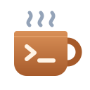
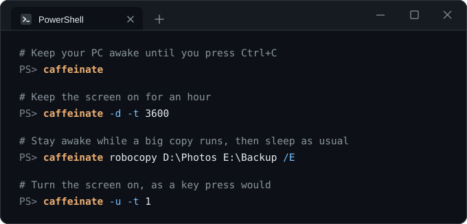

<p align="center">
  
</p>

<h1 align="center">caffeinate for Windows</h1>

<p align="center">
  The macOS <code>caffeinate</code> command, native on Windows.<br>
  Keep your PC awake, and the display on if you like, while a command runs,<br>
  until a process exits, for a set time, or until you press <kbd>Ctrl</kbd>+<kbd>C</kbd>.
</p>

<p align="center">
  <a href="https://github.com/metinata/caffeinate-win/actions/workflows/ci.yml"></a>
  <a href="https://github.com/metinata/caffeinate-win/releases/latest"></a>
  <a href="LICENSE"></a>
  
</p>

<p align="center">
  
</p>

## Features

- **Same command line as macOS.** `-d`, `-i`, `-m`, `-s`, `-u`, `-t`, `-w` and
  running a utility behave as documented in `caffeinate(8)`, so scripts and habits
  carry over.
- **One small executable.** A single `caffeinate.exe` of about 350 KB, with nothing
  else to install: no runtime, no background service. Works in any shell and in
  scripts.
- **Never gets stuck.** It uses Windows power requests, which the kernel drops as
  soon as the process ends, even if it is killed.
- **Easy to inspect.** It shows up in `powercfg /requests` with the reason, for
  example `caffeinate -d: npm run build`.
- **Runs commands like your shell.** It finds scripts such as `npm.cmd` and
  `.\gradlew.bat` the way `cmd.exe` does, passes the arguments on exactly as you
  wrote them, and passes the exit code back.

## Installation

Run this in PowerShell:

```powershell
irm https://github.com/metinata/caffeinate-win/releases/latest/download/install.ps1 | iex
```

The [install script](install.ps1) downloads the latest release for your machine, checks
its SHA-256 checksum, puts `caffeinate.exe` in `%LOCALAPPDATA%\Programs\caffeinate`
and adds that folder to your `PATH`. It needs no administrator rights. Run it again
to update.

<details>
<summary><b>Other ways to install</b></summary>

#### Download

Download the zip for your machine from the
[latest release](https://github.com/metinata/caffeinate-win/releases/latest),
`x86_64` for most PCs or `aarch64` for Windows on ARM, and extract `caffeinate.exe`
into a folder on your `PATH`.

Each release comes with SHA-256 checksums and
[build provenance attestations](https://docs.github.com/actions/security-for-github-actions/using-artifact-attestations/using-artifact-attestations-to-establish-provenance-for-builds).
To check that a download was built from this repository by its release workflow:

```console
> gh attestation verify caffeinate-x86_64-pc-windows-msvc.zip --repo metinata/caffeinate-win
```

#### Build from source

With [Rust](https://rustup.rs) 1.85 or newer and the MSVC build tools
(Visual Studio's "Desktop development with C++" workload):

```console
> cargo install --git https://github.com/metinata/caffeinate-win --locked
```

winget and Scoop packages are planned.

</details>

<details>
<summary><b>Uninstall</b></summary>

If you used the install script, delete its folder and take it off your `PATH`:

```powershell
$dir = "$env:LOCALAPPDATA\Programs\caffeinate"
Remove-Item -Recurse $dir
$key = [Microsoft.Win32.Registry]::CurrentUser.CreateSubKey('Environment')
$path = $key.GetValue('Path', '', 'DoNotExpandEnvironmentNames')
$key.SetValue('Path', (($path -split ';') -ne $dir) -join ';', 'ExpandString')
```

</details>

## Usage

```text
caffeinate [-dimsu] [-t timeout] [-w pid] [utility [argument ...]]
```

| Option | Effect |
|---|---|
| `-d` | Prevent the display from turning off. This also keeps the system awake. |
| `-i` | Prevent the system from sleeping when idle. This is the default if none of `-d`, `-i`, `-m`, `-s`, `-u` is given. |
| `-m` | Same as `-i`. Windows has no request that keeps disks from spinning down. |
| `-s` | Prevent the system from sleeping, but only while it runs on AC power. |
| `-u` | Declare that the user is active: turn the display on if it is off, reset the idle timers, and keep the display on for 5 seconds, or for the `-t` timeout. |
| `-t timeout` | Release after `timeout` seconds. Without a utility, caffeinate then exits. |
| `-w pid` | Release when the process with ID `pid` exits. Ignored when a utility is given. |
| `-h`, `--help` | Print help. |
| `-V`, `--version` | Print the version. |

Options can be combined, as in `-ds`. If a utility is given, caffeinate runs it,
keeps the system awake while it runs (with `-t`, for at most `timeout` seconds),
and exits with its exit code. Without a utility, caffeinate runs until the timeout
elapses, the watched process exits, or you press <kbd>Ctrl</kbd>+<kbd>C</kbd>. As
on macOS, `-t` counts only time the system is awake.

### Running a utility

caffeinate looks the utility up the way `cmd.exe` does: in `PATH`, trying each
extension from `PATHEXT`, so `npm` finds `npm.cmd` and `.\gradlew` finds
`gradlew.bat`. It starts programs (`.exe`, `.com`) and batch files (`.bat`,
`.cmd`); run other scripts through their interpreter, as in
`caffeinate cscript script.vbs`. Like PowerShell, it does not search the current
directory; write `.\build.cmd` for a script there.

The utility gets its arguments exactly as you wrote them, quotes included, as if
you had run it directly. Batch files are the exception: their arguments are quoted
again, so that `cmd.exe` cannot run part of an argument as a command. Windows
PowerShell (`powershell`) started from PowerShell 7 gets the same module path as
when PowerShell 7 starts it itself, without PowerShell 7's own modules.

PowerShell 7.3 and later escape quotes inside arguments (as `\"`) for every program
except a few that read their command line their own way, such as `cmd` and `find`.
caffeinate is not one of them, so `caffeinate find '"text"' file` hands `find` the
escaped quotes. To pass such quotes on, run
`$PSNativeCommandArgumentPassing = 'Legacy'` first, or start caffeinate from
`cmd.exe`.

A console utility receives <kbd>Ctrl</kbd>+<kbd>C</kbd> itself and decides whether
to exit; caffeinate then exits with its exit code. A GUI program never receives
<kbd>Ctrl</kbd>+<kbd>C</kbd>, so caffeinate stops waiting, exits with `130` and
leaves the program running.

If caffeinate is killed or its console window is closed, the utility ends too, as
on macOS, where caffeinate runs the utility in its own process. When caffeinate
exits by itself, whatever is still running keeps running, such as a server the
utility started in the background.

### Examples

```powershell
# Keep the system awake until Ctrl+C
caffeinate

# Keep the display on for an hour
caffeinate -d -t 3600

# Keep the system awake while a build runs
caffeinate -i cargo build --release

# Keep the system awake until a running process exits
caffeinate -w (Get-Process -Name robocopy | Select-Object -First 1).Id

# Keep the system awake, but only while plugged in
caffeinate -s

# Turn the display on, as a key press would
caffeinate -u -t 1
```

### Exit status

| Code | Meaning |
|---|---|
| `0` | The timeout elapsed or the watched process exited. |
| *utility's code* | A utility was given; its exit code is passed through unchanged. |
| `1` | Invalid arguments, an unknown process ID, or a Windows API error. |
| `126` | The utility was found but could not be started. |
| `127` | The utility was not found. |
| `130` | Interrupted with <kbd>Ctrl</kbd>+<kbd>C</kbd> or <kbd>Ctrl</kbd>+<kbd>Break</kbd>. With a utility, only before it started or if it is a GUI program. |

### Seeing what keeps your PC awake

Windows lists active power requests with `powercfg /requests`, run from an elevated
prompt. While caffeinate runs, it appears with its reason:

```text
DISPLAY:
[PROCESS] \Device\HarddiskVolume3\Tools\caffeinate.exe
caffeinate -d: npm run build

SYSTEM:
[PROCESS] \Device\HarddiskVolume3\Tools\caffeinate.exe
caffeinate -d: npm run build
```

## How it works

caffeinate creates a
[power request](https://learn.microsoft.com/windows/win32/api/winbase/nf-winbase-powercreaterequest),
the mechanism video players and presentation software use, and sets it to keep the
system and/or the display on. The request belongs to the process, so Windows drops
it as soon as caffeinate exits, for whatever reason.

See [docs/design.md](docs/design.md) for the full design.

## Differences from macOS

- `-m` behaves like `-i`, because Windows has no request for disk idle sleep.
- `-u` turns the display on with a mouse movement of zero distance, since Windows
  turns a display on only for input. That does not work from a session without a
  desktop, such as over SSH.
- `-s` follows the power source by checking it every 5 seconds.
- With a GUI utility, <kbd>Ctrl</kbd>+<kbd>C</kbd> ends caffeinate but not the
  program, because Windows does not deliver it to GUI programs.
- Only programs and batch files run directly as the utility. Other scripts need
  their interpreter, while macOS runs any executable file.
- `-w` can only wait for a process that caffeinate may open. From a normal prompt,
  that is your own processes; for a service or another user's process, run
  caffeinate from an elevated prompt.
- Exit codes are 32-bit on Windows. A utility's exit code is passed through as is.
- `-h`/`--help` and `-V`/`--version` are additions.

As on macOS, caffeinate only prevents *automatic* sleep. Sleep you trigger yourself
(Start → Power → Sleep, the power button, or closing the lid, depending on your power
settings) still happens.

## Alternatives

- [PowerToys Awake](https://learn.microsoft.com/windows/powertoys/awake): a
  keep-awake tool with a tray icon, part of Microsoft PowerToys.
- [PSCaffeinate](https://www.powershellgallery.com/packages/PSCaffeinate): a
  PowerShell module with caffeinate-style options.

## Contributing

Bug reports, ideas and pull requests are welcome. See
[CONTRIBUTING.md](CONTRIBUTING.md) to get started, and [SECURITY.md](SECURITY.md)
to report a vulnerability.

## License

[MIT](LICENSE) © 2026 Metin Ata YETER
